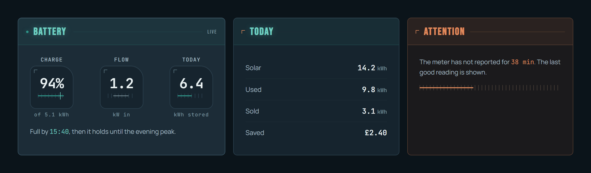
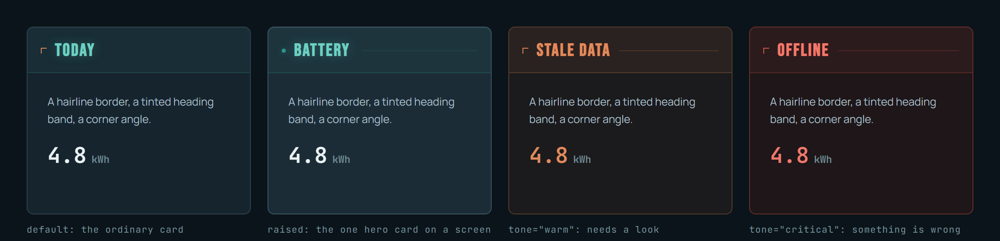
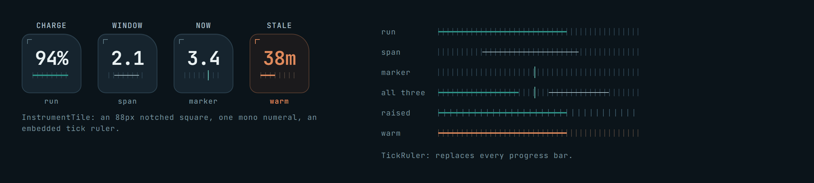
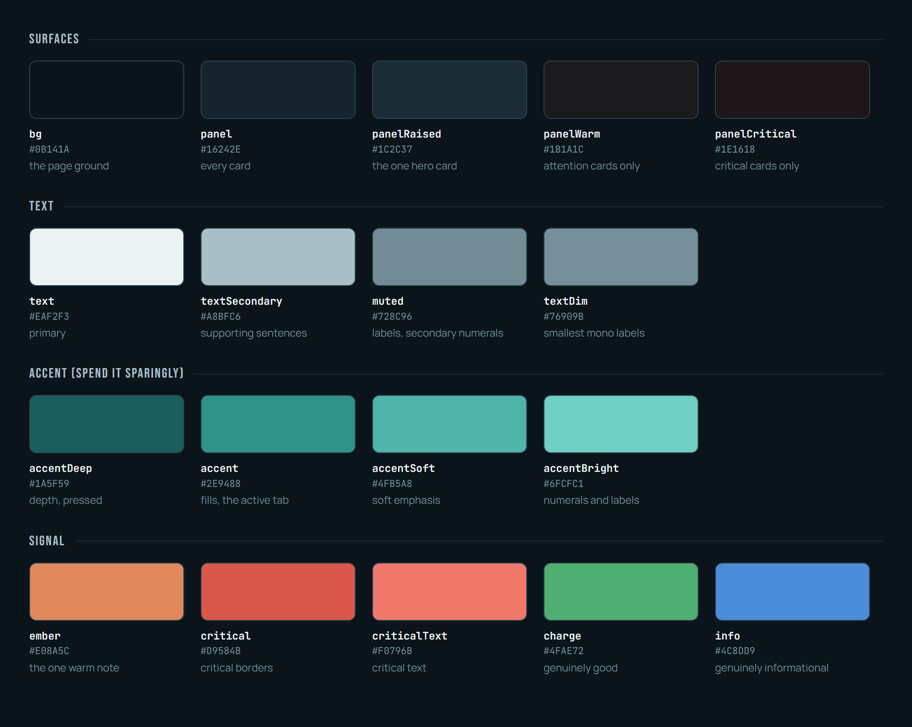
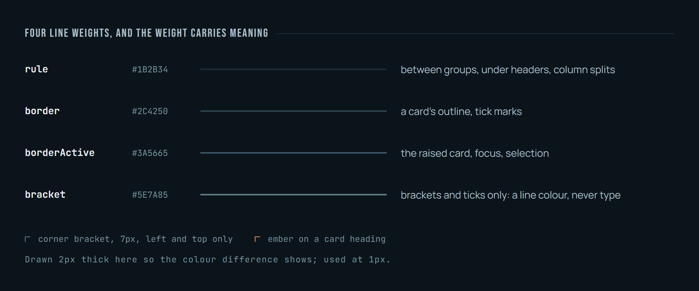
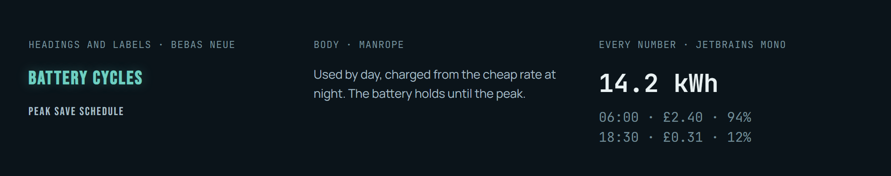

# Harbour Ink Engraved

A dark, cool, hairline design system: one teal accent, one warm signal colour, four line weights, and numbers that always sit on a mono grid. Five React primitives and a token set, extracted from the apps it was built for.



*Real components, rendered from this repository.*

## The four cards

The card is the one container. `raised` is the single hero card on a screen; `warm` and `critical` are for things that need a look.



## Instruments, not progress bars

Every single reading is an `InstrumentTile`, and every bar is a `TickRuler`: a run is a filled line from the left, a span is a thin line inset from both ends, a marker is a bright line that overhangs the strip.



## Colour

One cool family, one warm note. Warm is the only thing that says "look here".



## Lines and type





## What is in the box

| File | What it is |
|---|---|
| `src/theme.js` | The tokens as a JS object (`theme.panel`, `theme.accentBright`, ...) |
| `src/tokens.css` | The same tokens as CSS variables, for projects without the JS object |
| `src/fonts.js` | Loads Bebas Neue, Manrope and JetBrains Mono with `next/font/google` |
| `src/components/Block.js` | The card: corner angle, bold bright heading on a tinted band, hairline rule. `raised` for the one hero card, `tone="warm"` or `"critical"` for alerts |
| `src/components/Cap.js` | Condensed caption text whose letter-spacing tightens as it grows |
| `src/components/CornerBracket.js` | The 7px corner mark used instead of focus rings and bullets |
| `src/components/TickRuler.js` | A strip of ticks used instead of every progress bar, with run, span and marker overlays |
| `src/components/InstrumentTile.js` | An 88px notched square with a mono numeral, a label and a caption: the reading tile |
| `docs/PRINCIPLES.md` | The rules that make it look like this (read this first) |

## Using it

Needs React and Tailwind CSS v4 (the components use its utility classes) and the three font variables loaded (see `src/fonts.js`).

```jsx
import { theme } from "./theme";
import Block from "./components/Block";
import InstrumentTile from "./components/InstrumentTile";

<Block theme={theme} title="Battery">
  <InstrumentTile theme={theme} label="Left" value="4.8 kWh" caption="of 5.1 kWh" run={94} />
</Block>
```

Every component takes `theme` as a prop, so a project can pass its own token values.

## Not included

Icons (the apps use Lucide, which is ISC licensed), screens, and any app code. See `NOTICE.md` for the licences of what a project loads alongside it.

## Credits

Designed and directed by Nathan Allmont, built with Claude (Anthropic).
## Licence

MIT. See `LICENSE`.
